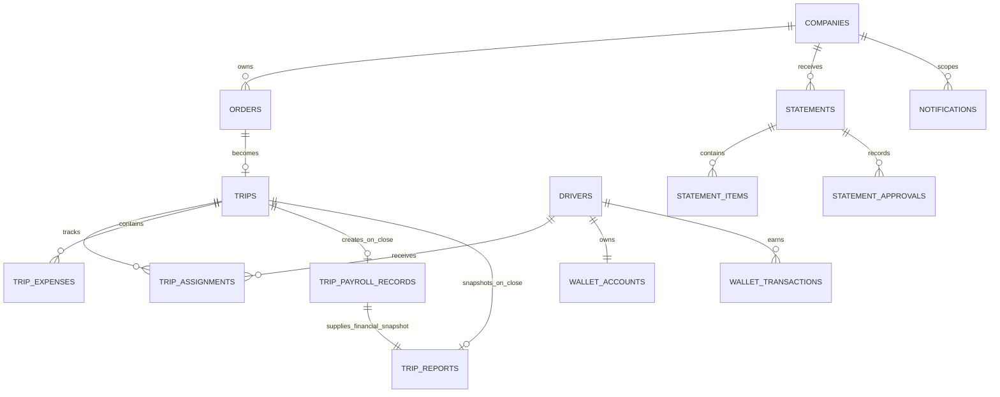

# HireD Database Design

**Database:** PostgreSQL (selected); the earlier 16+ proposal is not a pinned owner-approved version. Exact version remains DEC-01.

**Diagram source:** [hired.dbml](./hired.dbml)

**Reviewed:** 4 October 2026 against [HireD PRD v0.2](https://github.com/shahid123s/buildathon-resources/blob/main/hire_d_prd_doc.md), dated 30 September 2026.

This is a database design, not an implemented schema or migration. [prd-validation.md](./prd-validation.md) records the seven-area review and distinguishes PRD obligations from proposed implementation choices. The upstream link follows `main`; its commit is not pinned.

**Infrastructure update, 10 October 2026:** the owner selected managed PostgreSQL for staging/production, Docker PostgreSQL for local development/tests, and Redis for selected caching. See the [infrastructure plan](../infrastructure-plan.md). Exact PostgreSQL version/provider and Redis configuration remain open. These hosting choices do not change the DBML, transaction/locking rules or immutable financial history. PostgreSQL remains authoritative for sessions under the current draft, financial records, command replay and email intents; any later Redis session-authority decision needs a reviewed contract update.

## Design summary

One relational database serves the modular-monolith backend and all three interfaces.

| Interface | Primary tables |
| --- | --- |
| B2B partner portal | `companies`, `company_users`, `orders`, `trips`, `trip_reports`, `statements`, `statement_items` |
| Admin portal | Operational tables, driver onboarding, payroll, statements, reports, notification intents and audit logs |
| Driver mobile app | `drivers`, `driver_documents`, `driver_availability_dates`, assigned `trips`, `trip_expenses`, `trip_selfies`, own wallet and completed-trip reports |

## Prisma models and schema ownership

**Foundation implementation — 17 October 2026:** `backend/prisma/schema.prisma` and `backend/prisma/migrations/` now own the executable schema for `users`, `auth_sessions` and `user_role` only. They preserve the DBML names/native types and introduce compliant names for previously unnamed keys/indexes. Other tables and custom financial/workflow invariants in this guide remain unimplemented. Generate the ignored client with the pinned [backend commands](../../backend/README.md); never edit it directly.

The subsequent admin-auth increment adds `auth_sessions.transport`, consumed-token hashes in `auth_refresh_tokens`, durable HMAC-keyed `auth_rate_limits`, normalized email enforcement and transport/positive-counter CHECKs. The migration and [DBML](hired.dbml) agree. Refresh rotation locks its session row; reuse revocation commits even when authentication is denied. Existing case-colliding emails must be reconciled before migration, not silently merged. These authentication additions are separate from the command foundation below.

The command increment adds `command_replays` and implements the existing `audit_logs` design. [Command policy](../../backend/commands.md) specifies actor/method/canonical-path/key uniqueness, HMAC request fingerprints, bounded stored responses, 25-hour retention and transaction-scoped duplicate exclusion. Audit/replay/business effects share one transaction; audit triggers reject update/delete/truncate and actor deletion is restricted. Database CHECKs bound outcomes, expiry and JSON shape/size. Aggregate versions remain owned by future domain tables; authentication records do not gain unused versions. GAP-05's trip/upload portions remain open.

**Selected on 10 October 2026:** the Express backend uses TypeScript and Prisma ORM (DEC-33/34). The original selection preceded scaffolding; executable paths and implemented scope are now recorded above. ORM adoption preserves the current database inventory and API/report contracts.

| Artifact | Ownership |
| --- | --- |
| Current `hired.dbml` and these database guides | Reviewed design inventory and integrity requirements until scaffolding |
| `backend/prisma/schema.prisma` | One editable application model source; explicitly maps to existing PostgreSQL identifiers |
| `backend/prisma/migrations/` | Executable history for deployed structure, including reviewed custom SQL not represented by the model |
| DBML/ERD after scaffolding | Synchronized design references in the same schema-change PR; do not generate a second independent migration stream from them |
| Generated client/types and other tool outputs | Regenerate from the pinned model/toolchain; never hand-edit competing model definitions |

Record actual paths and generated-file tracking rules with the scaffold under DEC-01. Schema changes update the model, migrations and design references together; compare the migrated PostgreSQL catalog with both the model and custom-SQL requirements. A database introspection result must not silently replace reviewed definitions or remove unmapped invariants.

Use singular PascalCase models and camelCase fields with explicit table/column mappings: `TripReport` maps to `trip_reports`, and `companyId` maps to `company_id`. Preserve every DBML column, native type, nullable/default rule, composite/shared key, enum type/value and declared naming exception. Retain UUIDs, date/timestamp semantics and `jsonb` snapshots rather than accepting differing ORM defaults. See [naming rules](../naming-conventions.md#35-prisma-models-and-migrations).

Money stays exact PostgreSQL `numeric`: trip/payroll/expense/wallet values use existing `(12,2)`, statement totals `(14,2)` and percentages `(5,2)`. Select the pinned Prisma version's exact decimal mapping and runtime representation; do arithmetic with an exact decimal library or reviewed SQL, never JavaScript floating-point numbers. Preserve decimal-string API/report output and proposed rounding rules. Verify precision, overflow, rounding and serialization in integration tests. Prisma syntax/representations vary by version; consult [data modeling](https://www.prisma.io/docs/orm/data-modeling) and the [version transition guide](https://www.prisma.io/docs/orm/coming-from-prisma-orm-7) when pinning.

Keep specialized CHECKs, partial uniqueness, immutable-row triggers and locking SQL in reviewed migrations/repositories when the pinned model API cannot express them. Feature support varies by Prisma release; ORM adoption must not weaken the [integrity rules](indexing-strategy.md). Runtime validation, report JSON validation, authorization and company scoping remain explicit service responsibilities.

## ETA and duration storage

**PRD requirement:** B-04 is P1 and names a maps-derived estimate with admin override for orders/trips. **Owner-selected initial delivery:** manually supplied road distance plus a server speed policy gives a labelled rough estimate; external maps integration remains later work. See [travel-time estimation](../travel-time-estimation.md) for the formula, labels, provider boundary and unresolved calibration choices.

The revised draft stores:

| Field | Meaning |
| --- | --- |
| `route_distance_km` | Optional manually supplied road kilometres; positive decimal or NULL |
| `estimated_duration_minutes` | Stored automatic heuristic or later maps duration; positive integer or NULL |
| `estimated_duration_source` | Automatic basis: `distance_heuristic`, `maps` or NULL |
| `estimate_average_speed_kmh` | Positive server-selected speed for heuristic only |
| `estimate_policy_version` | Nonblank recorded heuristic policy version; NULL otherwise |
| `admin_eta_minutes` | Positive duration override or NULL; takes precedence |
| `eta_source` | `admin_override` when an override exists, otherwise the automatic source, otherwise NULL |
| `eta_calculated_at` | Calculation time of the stored automatic duration |
| `eta_updated_at` | Time of the latest estimate/override change |
| `eta_overridden_by_user_id` | Admin responsible for the current override; NULL when cleared |

The existing minute/timestamp names remain intact. They represent **duration**, not a wall-clock timestamp. Effective duration is `COALESCE(admin_eta_minutes, estimated_duration_minutes)`. Proposed display ETA is `(started_at, otherwise scheduled_pickup_at/requested_pickup_at) + effective duration`; label the time basis and rough estimate source. Without distance/valid policy or an override, show "Estimate unavailable", never a zero duration. Optional paired coordinates do not imply measured road distance.

Copy distance, automatic estimate/basis and all override/timestamp fields from order to trip at acceptance. After acceptance the trip is authoritative; order tracking projects its estimate from the linked trip rather than displaying a stale order copy. Keep the stored automatic basis while an override is active; clear the override only through an explicit admin action. Audit changes with before/after values, actor, reason and time. Freeze effective duration/source and effective heuristic evidence in the report. Policy/provider changes never silently recalculate existing results. This is route estimation, not GPS tracking.

The first heuristic uses `ceil(route_distance_km * 60 / estimate_average_speed_kmh)` with exact decimals. Average speed, business limits and policy version remain DEC-32 choices; no default speed is approved. The [indexing guide](./indexing-strategy.md) includes draft source/evidence/arithmetic constraints. Implement migrations and client enum handling together; the [ERD PDF](HireD_Phase_1_Database_ERD.pdf) was regenerated and verified from the current DBML on 10 October 2026, including these fields. See the [local export guide](erd-export.md) for the source hash, coverage and regeneration command.

## Driver onboarding status

**Required:** A-09 and D-02 require an application queue, four document types and admin activation. Existing `drivers.status` is the single operational state: `pending` on application, `active` after admin activation, and `inactive`/`suspended` for operational restrictions. The latter two are proposed extensions, not a formal verification workflow.

- Query pending applications using `(status, created_at)` and show their uploaded documents.
- `onboarded_at` and `activated_by_user_id` record the first activation. Preserve them on subsequent state changes; use `audit_logs` for every transition.
- Only active driver profiles with active user accounts can be assigned or execute trips. Check both flags on reads/writes; availability does not replace activation.
- `online_status` and the calendar are independent availability data, not onboarding states.
- Admin reviews uploads for operational use; no verified/rejected-document checklist or identity-certification status is introduced. PRD §3.2 excludes formal verification.

**Proposed activation policy:** require current, securely stored uploads for driving license, Aadhaar, PAN and PCC. Document completeness as a hard activation gate is not explicitly specified by the PRD and needs team confirmation. Replacement preserves document history and allows only one current document of each type (D-11, P2).

## Expense categories and completion

**Required:** D-08/D-09 and PRD §6 require trip/driver association, amount and description, entered before closure. `description` is nonempty after trimming. Proposed amount validation is `> 0`; a trip with no expenses uses explicit confirmation rather than a zero-valued placeholder.

`expense_type` is an optional category label at the API/UI boundary, defaulting to `other` in storage. Labels such as fuel, toll or parking may be offered as suggestions, but the PRD does not require a category catalog or category-specific reimbursement rules. Category omission cannot block expense entry. Receipts are optional.

The current driver confirms the complete list, including an explicit "No expenses" action when empty. Set `expenses_confirmed_at` and `expenses_confirmed_by_driver_id` together. Any add/edit/delete or reassignment clears both. Preserve previous drivers' expense entries and require the new driver to reconfirm the combined list; only original submitters who still have operational access may edit their entries. Expenses become immutable at closure.

Expenses appear individually and in a separate total in the report. They do not change the commission base or create wallet credits under the working rule in §5.4; §8.1 still labels exclusion an assumption, and reimbursement remains open (§8.3).

## Atomic closure and financial correctness

Use one PostgreSQL transaction for successful OTP closure:

1. Lock the company row, then the trip row. Rate edits lock the same company row, and any operation needing both locks uses this order.
2. Recheck the active account and current assignment. An already closed trip returns its stored result only to the recorded payroll driver, without another financial write.
3. Require `ongoing`, current-driver expense confirmation and a valid OTP. An empty expense list is allowed only through the proposed explicit no-expense confirmation.
4. Capture the server closure time and read the company rate effective at that time. Calculate exact numeric shares with proposed half-up rounding of driver share and company share as the remainder.
5. Close the trip and complete the active assignment; insert one immutable payroll record and one `trip_credit` with `idempotency_key = close-trip:<trip_id>`.
6. Update the cached wallet balance and create the immutable trip report linked to that payroll record. If optional driver scoring is enabled, record its update here. Add the audit event.
7. Persist any required outbox intent in the same transaction, then commit. Any failure rolls back closure, payroll, report, wallet and that intent together. External email sends happen after commit.

The coordinator passes the same Prisma transaction context to every participating repository and lock/query helper. Do not let a helper write through a standalone client. Keep company-then-trip row locking and permanent credit uniqueness even when ORM calls are typed. See [architecture](../system-architecture.md#4-transactions-that-must-stay-together).

Rates apply at closure, not assignment or acceptance. Partner payment timing never delays the wallet credit. Enforce one payroll, report and trip credit per trip with unique constraints/partial indexes. OTP hash validates driver input; the separate encrypted copy is only for authorized partner reveal. Failed OTP attempt counters must persist independently of rolled-back closure writes. Never place OTPs in reports, notifications or audit payloads.

The existing design permits a zero trip amount; its recorded trip credit may therefore be zero. This is a proposed price policy, not a PRD requirement. Do not reject a valid closure solely because its calculated credit is zero; any negative reversal/adjustment states remain reserved extensions.

**Proposed reassignment policy:** allow reassignment while assigned/ongoing, preserve the original start time, revoke the previous driver's operational access immediately, and pay the entire share to the current driver at closure. Closed reassignment and contribution splitting are not specified and need a product decision.

## Trip report snapshot

**Required:** B-05 and D-09 require automatic report generation on closure, with expenses and payroll information (§5.4). BASAP's JSON field is now defined by [trip-report-snapshot.schema.json](./trip-report-snapshot.schema.json).

The immutable version-1 payload contains:

- Report ID, contract version, generation time and currency.
- Trip/order/company identities and company display name; closing driver identity/name; pickup/drop addresses and optional paired coordinates; contact, vehicle/service notes, schedule, start and close timestamps.
- Final effective duration/source and, for a heuristic, copied distance/speed/policy evidence; actual elapsed seconds, confirmation timestamp/driver and assignment history with the actual drivers/times.
- Expense IDs, submitting driver, category, decimal-string amount, description, optional receipt asset ID and logging time; separate expense total.
- Payroll ID, trip amount, applied percentages, both shares, their total, payment/payout statuses **at closure**, and the persisted wallet credit ID/amount.

Store matching relational `trip_id`, `driver_id`, `company_id`, `payroll_record_id`, timestamps and total. Validate the JSON against the schema and reconcile IDs, arithmetic and chronology with those rows inside closure. Freeze decimal values as strings; ISO timestamps include offsets. `snapshot_version` identifies a format, not an editable report revision.

Do not embed OTPs, document numbers, identity files, credentials, private storage keys or signed URLs. Resolve receipt downloads through current authorization. Snapshot payment status remains the value at closure; a separately authorized live settlement view may change later. Partners see only their company report; drivers see only reports credited to them. The field-level schema and immutability mechanism are proposed implementations of the required generated report.

## Reporting and company scope

**Required:** all admins have equal cross-company visibility (§2); partners and drivers see only their own data (§7). No extra report-ownership or admin permission tier is introduced. Derive reports from normalized records and immutable payroll; a new report-storage table is unnecessary.

Proposed admin filters are a time range, optional `companyIds` (one/many; omitted means all), relevant `driverId`, and trip mode `live/daily/monthly`. Validate inputs; apply the same scope to rows, counts, totals, downloads and exports before pagination. A report filter is not authorization. Partner endpoints derive company scope from their account and reject selection of another company. Proposed MVP membership is one company per partner user.

| Required report (§5.5) | Source and proposed time basis |
| --- | --- |
| Billing issues | Statements/items versus payroll/trip/report values; statement period and trip closure time; flag cross-company lines and incorrect totals/rates |
| Driver delay | Scheduled pickup versus actual start, grouped by driver and selected companies; scheduled-trip range |
| Client order volume/success rate | Orders by creation time and company; closed-trip on-time metrics by scheduled time, reported with explicit denominators |
| Driver payouts | Payroll joined to trip credits, by payroll `calculated_at` (closure time), grouped by driver/company |
| Trip report: live/daily/monthly | Live is a proposed auto-refreshing ongoing list; daily/monthly use closure time for completed trips and scheduled time for operational views, labeled explicitly |
| Order report | Orders, status and outcome by creation time/company |
| Driver/staff work | Assignment activity by `assigned_at`, completions by closure time, grouped by driver/company; state which measure each date filter applies to |

Use start-inclusive/end-exclusive UTC ranges derived from the requested calendar timezone. Driver identity/availability is global; filter activity by trip company rather than assigning a driver to one company. Completed driver history uses payroll driver, not only `trips.current_driver_id`. On-time/grace thresholds, delivery targets, reassignment contribution metrics and the meaning of "live" remain undefined in the PRD; label any working metrics provisional. Report aggregations must not treat missing timestamps/ETA as on-time or delayed without an explicit policy.

## Statement verification and publication

**Required:** one statement per company/calendar month, closed trips, trip-wise applied rates and monthly totals; creator plus one different admin approves before publication (A-12, §5.4). Keep the lifecycle `draft → pending_verification → verified → published`. Existing `void` is a reserved extension with no MVP transition.

- Proposed month selection uses actual closure time and `billing_timezone = Asia/Kolkata`. `period_start` is the local first day; `period_end` is the exclusive first day of the next month. Generate completed months only (proposed policy).
- Statement items copy trip amount, both applied percentages and both shares from immutable payroll. Reject lines from another company/month; totals reconcile with lines. Expense totals never inflate the commission totals.
- Draft regeneration increments `content_version` and replaces lines atomically. On submission record `submitted_at` and freeze the content.
- Lock the statement for approvals. Each approval stores admin identity, time and the submitted `content_version`. Require the creator and exactly one distinct other admin; reject a second different noncreator. Record `verified_at` when the pair exists. Creation alone is not approval.
- Publishing rechecks both approvals/version, sets `status`, `published_at` and `published_by_user_id` together, audits the action, and inserts the publication email intent in the same transaction. A retry returns the existing publication without another intent.
- Proposed visibility is `published` only. PRD B-06/§5.4 require verification and say partner access follows verification, while §4.1 includes a distinct publication stage. Requiring publication as well follows that lifecycle but remains a clarification, not an additional confirmed PRD requirement.
- Provider failure does not revert publication or hide a published statement. Email delivery is tracked separately; settlement remains outside the platform.

## Email intent and delivery tracking

**Required:** B-07 specifies partner email on order acceptance, rejection and statement publication. Rejection is also required by P0 A-05, so it cannot wait for all P1 notification work. Push/SMS/in-app events remain open; the existing channel values are reserved extensions.

`notifications` is a transactional outbox: one durable email intent per event/resource/recipient/channel, protected by `deduplication_key`. Typed events have explicit `company_id` and exactly the matching `order_id` or `statement_id`. Snapshot recipient email and template/version with minimal content. Proposed recipients are active partner accounts marked `is_primary_contact`; if none is designated, use the active partner account that created the order, or all active company partner accounts for an admin-created order/statement. Recipient policy needs confirmation. Flag a missing recipient for admin action; never silently report successful notification.

Enqueue in the same transaction as acceptance, rejection or publication. A worker claims pending due rows with a lease/token, increments attempts, and sets `processing`; expired leases are reclaimable. Send outside the DB transaction, acknowledge only the current claim, and either set `sent` with provider ID/time, schedule another attempt, or mark terminal `failed`. Retain sanitized failure text. Use bounded exponential backoff and a finite retry limit (proposed policy).

`sent` means provider acceptance, not verified mailbox delivery. Durable deduplication prevents duplicate intent creation, but delivery is at least once if a worker crashes after sending. Pass the same key to a provider supporting idempotency; do not promise exactly-once email delivery otherwise. Operational/report/publication success remains committed during email outages.

## Integrity and performance

Implement FK, CHECK and partial-index rules in migrations; DBML notes do not enforce them. See [indexing-strategy.md](./indexing-strategy.md) for proposed SQL. Services/triggers enforce role checks, cross-table company/trip consistency, statement approval gates, immutable financial/report rows, and assignment/confirmation consistency under locks.

Keep files in private object storage, distribute authorized short-lived links, and keep audit logs append-only. Wallet balances are transactional caches reconciled against the ledger. The PRD does not define offline cash-out debits; cumulative credits versus spendable balance needs confirmation.

## Optional driver recommendation extension

Existing `driver_performance_summaries`, `driver_score_events` and assignment scores are BASAP suggestions, not PRD requirements. If adopted, use an explainable recommendation based on availability, experience, punctuality and configurable scores; admin retains control. Do not make honor-score thresholds or automatic scheduling exclusions a P0 requirement. Do not penalize permission, network or OTP-entry failures as driver misconduct. Scoring/streak policy and approved delay thresholds require a separate product decision.
