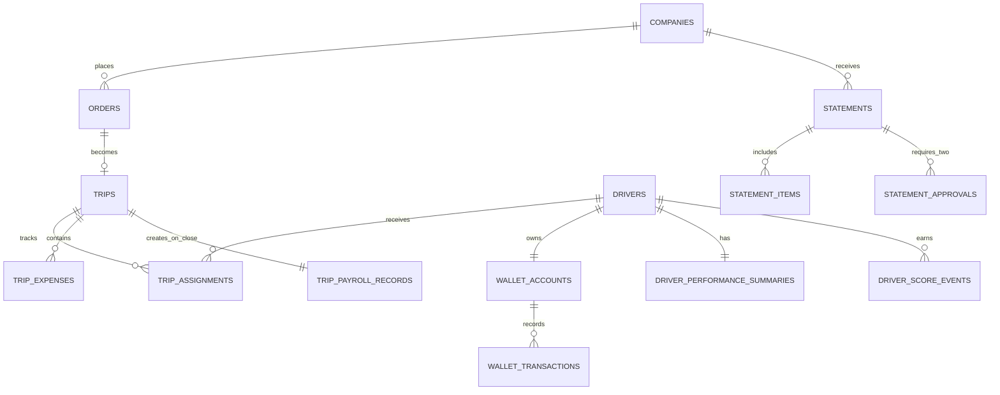

# HireD Database Design

**Database:** PostgreSQL 16+  
**Diagram source:** [`hired.dbml`](./hired.dbml) — import it into [dbdiagram.io](https://dbdiagram.io) to render the ERD.

## Design summary

This relational model serves all three product interfaces through one modular-monolith backend:

| Interface | Primary tables |
|---|---|
| B2B business portal | `companies`, `company_users`, `orders`, `trips`, `statements`, `statement_items` |
| Admin portal | All operational tables, especially orders, trips, assignments, payout rates, performance, payroll, statements, and audit logs |
| Driver mobile app | `drivers`, `driver_documents`, `driver_availability_dates`, `trips`, `trip_expenses`, `trip_selfies`, `wallet_accounts`, `wallet_transactions` |

## Important relationships



## Driver assignment recommendation

Use an explainable score rather than selecting only by completed-trip count. First filter eligible drivers:

1. `drivers.status = 'active'` and `online_status = true`.
2. No `driver_availability_dates` record marking the requested date unavailable.
3. No active assignment overlapping the trip time window.
4. Exclude drivers below a chosen safety threshold (recommended honor score: 40).

Then rank the remaining drivers. Store the resulting recommendation score and reason in `trip_assignments` whenever the admin assigns or reassigns a driver.

```text
priority_score =
  35 × experience_score       // completed trips, capped at 100
+ 30 × honor_score            // current 0–100 conduct score
+ 20 × availability_score     // online and no scheduling conflict
+ 10 × on_time_score          // on-time / completed trips
+  5 × streak_score           // current good streak, capped at 10 trips
```

All component scores are normalized to 0–100. Admin retains final control; the algorithm is a recommendation, not automatic dispatch.

## Honor score and streak rules

`driver_performance_summaries` is a fast read model for the directory and assignment query. `driver_score_events` is the append-only, auditable source for every change.

Suggested initial policy (make these constants configurable in the application):

| Event | Score change | Streak effect |
|---|---:|---|
| Trip closed correctly with OTP and required expenses | +1, capped at 100 | +1 |
| Every 5 consecutive good trips | +2 bonus, capped at 100 | unchanged |
| Trip not closed properly / failed close process | -15 | reset to 0 |
| Late trip start (after an approved grace period) | -5 | reset to 0 |
| Valid admin adjustment | bounded manual change with reason | as recorded |

On the successful close transaction, insert the `trip_completed` score event and update the summary. For a negative event, insert a separate event; never overwrite history. This lets the team explain exactly why a driver's score changed.

## Financial correctness

On OTP-validated trip close, use **one PostgreSQL transaction**:

1. Lock the trip row (`FOR UPDATE`) and confirm it is still `ongoing`.
2. Confirm required expense entries exist and validate the OTP hash. The partner-facing OTP is stored separately as an application-encrypted value, so it can be shown only to that company's authorized partner users.
3. Find the company payout rate effective at close time.
4. Mark the trip closed; insert its immutable `trip_payroll_records` snapshot.
5. Insert exactly one `wallet_transactions` credit using `idempotency_key = close-trip:<trip_id>`.
6. Update `wallet_accounts.balance`, summary performance, and audit log.
7. Commit. Any failure rolls back everything.

The unique `trip_id` in `trip_payroll_records` and unique idempotency key / trip ID in the wallet ledger prevent duplicate payout on an API retry. All money uses `numeric`, never floating-point.

## Integrity rules to enforce in migrations

- Only users with `role = 'admin'` may create payout rates, assignments, approvals, or admin audit actions (application authorization; add triggers if desired).
- A company's active payout rate must total exactly 100%. Use a `CHECK` constraint plus a rate-write transaction/trigger.
- One trip has at most one **active** assignment. In PostgreSQL add: `UNIQUE (trip_id) WHERE status = 'active'`.
- `trips.current_driver_id` must equal the driver in the active assignment. Enforce in the assignment service (or a deferred trigger).
- A statement has exactly one period per company: `UNIQUE(company_id, period_start)`.
- Publishing requires exactly two distinct approvals, one from `statements.created_by_user_id` and one from another admin. Enforce in the publish service/trigger.
- Portal queries must always scope data through `company_users`; drivers scope through `drivers.user_id`.

## Cost and performance decisions

- Store only private object-storage keys in `file_assets`; documents, receipts, and selfies belong in S3/R2/MinIO—not PostgreSQL blobs. Deliver short-lived signed URLs.
- The normal path reads narrow, indexed tables: order inbox by `(status, created_at)`, driver trip list by `(current_driver_id, status)`, completed-trip reporting by `(company_id, closed_at)`, and wallet history by `(driver_id, created_at DESC)`.
- Maintain `wallet_accounts` and `driver_performance_summaries` as small transactional read models rather than repeatedly aggregating every ledger/trip row on mobile/admin screens.
- Keep `audit_logs` append-only. Partition it monthly only when volume justifies it; do not add infrastructure early.
- Generate month-end statements from immutable payroll records, then retain `statement_items` snapshots so the historical invoice cannot change when operations data is edited.

## Assumptions made

- A driver is assigned by an admin; the driver cannot accept/reject an assignment, matching the PRD.
- Expenses are recorded but excluded from the commission split, matching the PRD's current assumption.
- Admin-created phone/WhatsApp orders still have a company and a `created_by_user_id` admin.
- OTP values are stored as a secure hash and not as plaintext.
