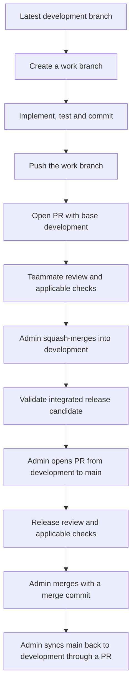

# HireD Git Workflow and Contribution Rules

**Applies to:** all five contributors: three full-stack developers, one Flutter developer and one penetration tester, including anyone who also holds repository-admin authority.

**Repository:** [BASAP on GitHub](https://github.com/Buildathon-HireD-Brototype-2026/BASAP).

**Status:** team workflow documented on 4 October 2026. **MUST** means required; **MUST NOT** means prohibited. GitHub calls a merge request a **pull request (PR)**; this document uses PR throughout. Repository protection settings and CI requirements below are admin setup tasks, not settings verified or installed by this document.

## 1. Agreed flow and recommended additions

The repository admin manages the repository. Contributors clone it, create a work branch from the latest `development`, implement their change, commit and push that work branch, then open a PR targeting `development`. Nobody develops directly on `development` or `main`. Only the repository admin may merge into `main`.

This guide adopts the following additions to make that flow enforceable and manageable:

- The admin also performs merges into `development`; teammates review and approve but do not merge protected branches. This is an addition to the original main-only merge restriction.
- Every PR requires at least one approval from a teammate other than its author. Admin-authored changes require another teammate's approval too.
- Ordinary work-branch PRs are squash-merged into `development`. Releases and the explicit admin synchronization PRs in Section 8 use merge commits, preserving shared history.
- Each work branch represents one focused task. Draft PRs expose work early; incomplete work is not merged as ready functionality.
- Database/API changes include their impact on React and Flutter. Security-sensitive changes involve the penetration tester.
- Branch protections, required checks and review rules enforce the policy; written rules alone do not prevent a direct push.



## 2. Branch rules

| Branch | Purpose | Development allowed? | Allowed incoming PRs | Who merges? |
| --- | --- | --- | --- | --- |
| `main` | Stable, approved release history | No | `development` only | Admin only |
| `development` | Reviewed integration of team changes | No | Work branches; admin-managed synchronization PRs from `main` | Admin only |
| Work branch | One feature, fix, test or documentation task | Yes | Normally none; update it from `development` locally | Its owner maintains it; it is merged through a PR into `development` |

All new work branches MUST start from the latest `origin/development`. Contributors MUST NOT branch from `main`, another person's work branch or a stale local development branch. They MUST NOT commit or push directly to `main` or `development`. The admin follows the same PR process rather than bypassing it.

New work branches MUST use `<type>/<short-description>`, with lowercase kebab-case after the slash. An issue number may prefix the description: `feature/42-trip-otp-close`. Allowed types are `feature`, `fix`, `docs`, `refactor`, `test`, `security` and `chore`.

| Work | Example |
| --- | --- |
| New feature | `feature/trip-otp-close` |
| Bug fix | `fix/duplicate-wallet-credit` |
| Flutter work | `feature/mobile-trip-details` |
| Security testing | `security/partner-access-tests` |
| Documentation | `docs/git-workflow` |
| Tooling, Docker or CI configuration | `chore/docker-api-build` |

Each branch has one owner. Other contributors MUST coordinate with that owner before pushing to it. Work branches MUST NOT be reused after squash merge; start a new branch for the next task. Force pushes to protected branches or another contributor's branch are prohibited. The standard update procedure uses merge, so no force push is needed.

Urgent fixes also start from `development` and follow this flow, with expedited review. There is no automatic hotfix exception permitting a direct push or a branch from `main`. If the team later needs isolated production hotfixes, the admin must first document a separate exception and its synchronization process.

## 3. Contributor procedure

### First clone and create a branch

The following commands are instructions for a contributor, not commands executed by this documentation change. Replace the example work-branch name with your task.

```bash
git clone https://github.com/Buildathon-HireD-Brototype-2026/BASAP.git
cd BASAP
git fetch origin
git switch development
git pull --ff-only origin development
git switch -c feature/trip-otp-close
git branch --show-current
```

For an existing clone, begin with `git status --short`; preserve or commit outstanding work before switching branches. `git pull --ff-only` must succeed before creating a branch. If it fails, inspect why the local branch diverged; do not reset away work to continue.

### Implement, verify, commit and push

1. Confirm you are on your work branch.
2. Implement the agreed task and follow [naming-conventions.md](naming-conventions.md).
3. Run applicable checks and review the diff. Include related API/schema/client documentation when a contract changes.
4. Stage only the intended files. Inspect the staged diff before committing.
5. Commit using Section 4 and push the work branch.
6. Open a PR with **base `development`** and **compare your work branch**. Assign the reviewer(s) described in Section 6 and the admin as the merge owner.

In the commands below, replace `path/to/changed-file` with the actual files you intend to include; do not run it literally.

```bash
git status --short
git diff --check
git diff
git add path/to/changed-file
git diff --cached
git commit -m "feat(trips): add OTP closure validation"
git push -u origin feature/trip-otp-close
```

The commit and branch are examples, not an implemented feature. Do not stage unrelated generated outputs, local configuration, credentials or unrelated work. Use dummy values for test/configuration examples.

### Keep an open work branch current

Update after related work lands and again before final review. Remain on your work branch:

```bash
git branch --show-current
git fetch origin
git merge origin/development -m "chore(git): sync development into work branch"
```

If there are conflicts, inspect them, coordinate with the owner of the affected area and resolve them deliberately. Stage the resolved files, complete the merge commit, rerun affected checks and push normally. If you cannot safely resolve the merge, `git merge --abort` cancels that attempted merge so you can coordinate first. New review-affecting commits require renewed approval.

After the admin squash-merges the PR, delete only the merged work branch, refresh the local `development` with `--ff-only` and create a fresh branch for subsequent work. Do not delete either protected branch. Local `git branch -d` may refuse a squash-merged branch because commit ancestry differs; verify the PR and preserve any remaining work before arranging cleanup rather than blindly forcing deletion.

## 4. Commit-message standard

New contributor commits MUST use this project-specific form based on [Conventional Commits](https://www.conventionalcommits.org/en/v1.0.0/):

```text
type(scope): short description

Optional body explaining the reason and relevant behavior.

Refs: #42
```

Type and scope are required and lowercase. The scope is a domain or layer in lowercase kebab-case. The subject MUST be at most 72 characters, use an action verb, and omit a trailing full stop. Vague subjects such as `changes`, `update`, `done` or `final commit` are prohibited. Body/footer content is optional unless needed to explain a breaking change.

| Type | Use |
| --- | --- |
| `feat` | Add application behavior |
| `fix` | Correct a defect, including a security defect |
| `docs` | Change documentation |
| `refactor` | Restructure implementation without changing behavior |
| `test` | Add or update meaningful tests/security regression checks |
| `perf` | Improve performance |
| `style` | Formatting-only changes |
| `build` | Build tooling, dependencies or image-build changes |
| `ci` | CI configuration |
| `chore` | Maintenance not covered by another type |
| `revert` | Revert a prior change, with its reason and reference |

Use scopes such as `orders`, `trips`, `drivers`, `payroll`, `wallet`, `statements`, `notifications`, `auth`, `database`, `api`, `web`, `mobile`, `docker`, `workflow` and `git`. A cross-layer change may use its business scope; do not list several scopes in one header.

```text
feat(trips): add OTP closure validation
fix(wallet): prevent duplicate trip credits
docs(workflow): define contribution and review rules
test(auth): verify partner company isolation
build(docker): add API runtime image
```

A breaking contract change MUST include `!` after the scope and a `BREAKING CHANGE:` footer explaining the compatibility/migration impact:

```text
feat(api)!: replace the trip closure request format

Introduce the new request contract and update affected clients.

BREAKING CHANGE: Clients must use the documented replacement fields.
Refs: #42
```

Conventional Commits permits optional scopes; requiring a scope, the 72-character limit and the vocabulary above are HireD rules. Existing history does not need rewriting. GitHub-generated release/synchronization merge commits are explicit exceptions to the contributor header format. Admin-created squash subjects MUST use the same format as the PR title.

## 5. Pull-request title and description

A work PR title MUST use the commit-header format, for example:

```text
feat(trips): add OTP closure validation
```

The title describes the final change and becomes the squash-commit subject. Keep it current if scope changes. A Draft PR may be opened early, but MUST be marked ready only when the author has completed applicable checks and filled in the description.

Copy the template below into the PR description. Remove instructional text and use `Not applicable` with a reason where appropriate. The template is documented here; no automatic GitHub PR template is installed by this file.

```markdown
## Change and reason
Explain the problem, the resulting behavior and why this change is needed.
Include a concrete before/after example where useful.

## Task reference
Refs: #42
Or link the agreed task if it is tracked elsewhere.

## Changes
- Describe the main changes a reviewer needs to assess.

## Validation
List checks actually run and their results.
For manual checks, describe the scenario and observed result.
Attach relevant React/Flutter screenshots when the UI changes.
State any checks not run and why.

## Contract and integration impact
State any database migration, JSON/API change, environment variable,
Docker change or React/Flutter coordination needed.
For breaking changes, describe compatibility and rollout steps.

## Risks and rollback
State known limitations and how to reverse the application change.
Explain migration/data recovery separately when relevant.

## Review checklist
- [ ] Base branch is development and the work branch began there.
- [ ] Diff contains only the intended task.
- [ ] Names follow docs/naming-conventions.md.
- [ ] Applicable checks and their results are recorded above.
- [ ] Related contracts and documentation are updated.
- [ ] Required reviewers and the admin are assigned.
```

Use `Refs: #42` for work PRs into `development` and manually link the issue. Do not assume `Closes #42` will close it there: GitHub's automatic closing behavior depends on merging into the repository's default branch. The admin must choose a consistent issue-completion point, preferably closing implementation tasks after the development merge while recording release delivery separately. [GitHub issue-linking behavior](https://docs.github.com/en/issues/tracking-your-work-with-issues/using-issues/linking-a-pull-request-to-an-issue)

A PR author MUST respond to review comments and update the same work branch. Reviewers mark substantive issues as changes requested; authors MUST NOT treat their own response as independent approval. Resolved discussions and fresh approval are required before merge.

## 6. Responsibilities for the five-person team

Repository-admin authority is separate from a development role and may be held by one of these five people. Being a reviewer does not grant merge permission.

| Role | Contribution and review responsibility |
| --- | --- |
| Three full-stack developers | Backend/Express, React, APIs, database integration and Docker/tooling. Rotate review responsibility so another developer reviews the author's change. |
| One Flutter developer | Mobile implementation and mobile validation. Review API/JSON changes affecting Flutter and coordinate client compatibility with full-stack developers. |
| One penetration tester | Security tests, findings, fix verification and regression cases, particularly authentication, company/driver isolation, OTP handling and uploaded files. |
| Repository admin | Access management, protected-branch setup, merge decisions, release coordination and branch cleanup. Only this role merges protected branches. |

Every PR requires at least one non-author teammate's approval. Assign relevant reviewers as follows:

- Backend/database/React changes: another full-stack developer.
- Flutter changes: a full-stack reviewer checks integration/contracts; the Flutter author records mobile validation. The sole Flutter developer is not expected to approve their own PR.
- Shared API/JSON changes affecting mobile: full-stack and Flutter review/validation must both be represented. If one role is the author, that author supplies validation and the other role supplies independent review.
- Authentication, authorization, OTP, upload or secret-handling changes: include the penetration tester's security review in addition to the relevant implementation review. If the tester is the author, an independent full-stack reviewer approves and the tester records security evidence.
- Documentation/tooling changes: a teammate familiar with the affected area.

The admin may provide the independent review if qualified and not the author. Security findings containing exploitable details or credentials must use an admin-approved private reporting channel, not a public PR description. Public fix PRs should explain behavior and regression coverage without exposing secrets.

## 7. Required validation

Checks are proportional to the change; unrelated checks need not be rerun. A failed applicable check blocks readiness for merge. PRs must report actual evidence, not claim planned checks passed.

| Area changed | Required evidence as applicable |
| --- | --- |
| Documentation/DBML/ERD | Diff/link checks, schema syntax validation when changed, and visual inspection when diagrams/PDFs change |
| Express/JS/TS/API | Configured lint/type/build checks and affected behavior/integration tests |
| React | Configured build/lint/type checks, relevant tests and manual UI evidence |
| Flutter | Formatting/analyzer checks, relevant tests and device/emulator validation for changed mobile behavior |
| Database/JSON contract | Schema/migration validation and relevant compatibility, ownership and financial-invariant checks |
| Docker/Compose | Dockerfile/Compose validation and affected image/startup checks |
| Security | Reproduction/verification evidence and regression coverage; no actual credentials in test artifacts |

BASAP currently contains design documents rather than an implemented app/CI pipeline. Do not invent commands or successful checks for missing tooling. As implementation lands, the admin must register meaningful CI checks as required protections. Until then, reviewers verify the applicable manual evidence recorded in the PR.

## 8. Admin merge and release procedure

### Work branch into development

1. Confirm the PR base is `development`, the task is focused and the title follows Section 4. This procedure applies to ordinary work PRs; Section 8's admin synchronization PRs use merge commits instead.
2. Confirm relevant approvals, resolved discussions and successful applicable checks against the latest changes.
3. Update/recheck the work branch if integration has changed underneath it.
4. **Squash and merge** using the PR title as the commit subject and retaining relevant task/author attribution.
5. Close/update the tracked task at the chosen completion point and delete only the merged work branch.

### Development into main

1. Validate the integrated release candidate, including the complete order/trip/report/wallet flow affected by the release and mobile/API compatibility.
2. The admin opens a PR with **base `main`, compare `development`**. A contributor work branch MUST NOT target `main`.
3. Use a title such as `chore(release): prepare v0.1.0`. List included PRs, validation evidence, migrations/configuration changes, deployment order and rollback considerations. The version is illustrative; choose the actual release version deliberately.
4. Obtain a non-author review and passing applicable checks for the release candidate.
5. The admin selects **Create a merge commit**, not squash/rebase, preserving the common history of the two long-lived branches.
6. Record the release/tag and deployment outcome when a release is actually made. Merging does not itself prove deployment.
7. Open a synchronization PR with **base `development`, compare `main`**, for example `chore(git): sync main after release`. After review and applicable checks, the admin merges it with a merge commit. Coordinate further development merges while this synchronization is pending.

Use squash only for short-lived work branches. Keeping `development` as the repeatedly squashed head of release PRs can reintroduce already merged commits; preserving ancestry avoids that problem. [GitHub merge-method guidance](https://docs.github.com/en/pull-requests/reference/pull-request-merges)

If the release PR itself conflicts, the admin resolves it on a temporary work branch created from `development`, merges `origin/main` into that work branch, and opens a synchronization PR back to `development`. Merge that synchronization with a **merge commit**, preserving ancestry, then revalidate the release PR. No direct development-branch edits are permitted.

A rollback uses reviewed revert/fix work through the same PR process. Database/data rollback must be assessed separately; reverting application code does not automatically undo a migration or a wallet/report side effect. Do not force-reset protected branches.

## 9. GitHub settings the admin must configure

Apply protection to the exact branch names `main` and `development`, not all feature branches:

| Setting | Required project policy |
| --- | --- |
| Pull requests | Required for protected-branch updates, including the admin's changes |
| Merge/update authority | Only the designated repository admin may update either protected branch through an approved PR |
| Approvals | At least one eligible non-author approving reviewer |
| Review changes | Dismiss stale approvals when review-affecting commits are pushed |
| Conversations | Require review conversations to be resolved |
| Status checks | Require the actual configured checks relevant to the protected branch; avoid selecting nonexistent job names |
| Fresh integration | Require the PR to be current with its base when using strict status checks |
| Force pushes and deletion | Disabled for both protected branches |
| Bypass | Apply review/check rules to the admin too; no routine bypass |
| Merge methods | Enable squash and merge commits; use the methods in Section 8 and disable rebase merging for this workflow |
| Linear history | Do not require it on these protected branches: release/synchronization merge commits must remain possible |

Give other contributors the repository access needed to push work branches and review PRs, without granting repository administration. Use protected-branch update restrictions to limit integration to the designated admin. Do not add CI apps or additional administrators to a bypass/update allowlist without explicitly reviewing their authority.

Availability of protection/update-restriction features depends on the GitHub repository visibility, organization and plan. The admin must verify the resulting settings and test that a non-admin cannot update either protected branch. This document does not establish that those controls are already active. [GitHub protected-branch settings](https://docs.github.com/en/repositories/configuring-branches-and-merges-in-your-repository/managing-protected-branches/about-protected-branches)

Restricting who can push is not by itself a ban on all direct pushes; pair it with required PRs and the admin bypass restriction. Work-branch naming and permitted PR source branches require review or a dedicated check; standard branch protection does not automatically enforce every rule in this document.

## 10. Practical improvements to adopt

- Keep PRs focused and review them regularly. Rotate full-stack reviewers to reduce dependence on one person while keeping admin merge authority.
- Agree on API/JSON contracts before backend and Flutter implementation diverge. Link dependent PRs and do not merge code that requires an unavailable contract.
- Keep `development` usable by integrating complete increments and using documented feature flags for incomplete user-visible features where necessary.
- Add an automatic PR template, commit-title validation, naming checks and meaningful CI as the implementation grows. These are follow-up setup tasks; no such automation is created here.
- Add CODEOWNERS only after actual GitHub handles and directory ownership are agreed. It assigns review responsibility, not merge authority.
- Preserve the simple two-branch integration/release model. Extra permanent release branches are unnecessary unless the team begins maintaining multiple supported releases.
