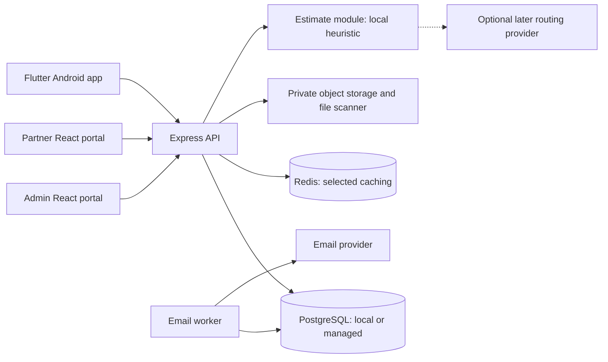

# System architecture

**Status:** implementation plan, updated 10 October 2026. The project owner selected an Express modular monolith in TypeScript with Prisma ORM, Docker, Redis and managed PostgreSQL. Providers and detailed configuration remain open. The application, migrations and production infrastructure are not implemented yet.

Use this guide to understand where code belongs. Use the [workflows](workflows.md), [OpenAPI contract](api/openapi.yaml) and [database design](database/database-design.md) for exact behavior. Resolve open choices through the [decision log](decision-log.md).

## 1. The main parts

Build one modular Express backend in TypeScript with Prisma ORM for both React portals and the Flutter Android app. A modular monolith means one backend codebase with clear business boundaries. Modules call each other's service interfaces inside the process; they do not need separate HTTP services.

Use Docker for development and deployment of the web applications and backend/worker. Run PostgreSQL locally in Docker; use a managed PostgreSQL provider for staging and production. Add Redis for selected caching, with session storage still conditional on the authentication decision. See [Docker, Redis and managed database plan](infrastructure-plan.md).

For the initial build, the estimate module uses optional manually supplied road kilometres and a configured speed policy. No external routing provider is required. Keep a provider adapter boundary for later integration; see [travel-time estimation](travel-time-estimation.md).

Run the email worker as a separate process/container built from the same backend code. PostgreSQL outbox records coordinate its work. Redis queue tooling is optional and not selected; Redis adoption alone does not replace the outbox. Microservices and continuous GPS tracking are not prerequisites for Phase 1.

| Part | Owns | Must not decide |
| --- | --- | --- |
| Admin portal | Dispatch, onboarding, company/rate management, statement review and reporting UI | Whether a forbidden action is authorized |
| Partner portal | Own-company orders, tracking, code reveal, reports and statements | Company ownership from a form field |
| Driver app | Own assignments, uploads, expenses, close-code entry and earnings UI | Successful closure or credit while offline |
| Express API | Authorization, validation, lifecycle rules and transaction boundaries | Trust in client-supplied role or calculated shares |
| PostgreSQL | Durable records, relationships, uniqueness and atomic financial changes | File bytes or raw refresh credentials |
| Redis | Rebuildable cached reads with explicit scope/expiry; optional additional roles after review | Authoritative rates, assignment, financial results or an authorization bypass |
| Estimate module, inside the backend | Labelled rough durations from supplied road distance/server policy; admin override and later provider adapters | Measured road distance from address text, traffic-aware claims or financial penalties |
| Private storage/scanner | Upload quarantine, file content and clean/rejected outcome | Public access to documents or selfies |
| Email worker | Delivery attempts for committed notification intents | Re-running acceptance or publication to send an email |

## 2. Backend feature boundaries

| Feature | Main records | Responsibility |
| --- | --- | --- |
| Authentication/accounts | users, auth_sessions, company_users | Identity, sessions and memberships |
| Companies/rates | companies, company_payout_rates | Company details and rate history |
| Drivers/files | drivers, driver_documents, file_assets, driver_availability_dates | Operational onboarding, private attachments and availability |
| Orders | orders | Intake, decision and accepted-order snapshot |
| Trips | trips, trip_assignments, trip_selfies, trip_expenses | Assignment, start, expense confirmation and closure |
| Payroll/earnings | trip_payroll_records, wallet_accounts, wallet_transactions | Recorded shares and one credit per closed trip |
| Reports/statements | trip_reports, statements, statement_items, statement_approvals | Frozen reports, monthly statements and approvals |
| Operations | notifications, audit_logs | Email outbox and sanitized audit trail |

Keep routing, HTTP validation, business logic and database access separate. Controllers translate HTTP requests; services enforce workflows; repositories issue database queries through Prisma ORM and reviewed parameterized SQL where required. Use the filenames and identifiers in [naming conventions](naming-conventions.md). TypeScript and Prisma are selected under DEC-33/34; the team still needs to pin compatible versions, concrete directory layout and Prisma generation/migration workflow; see DEC-01 in the [decision log](decision-log.md).

Each module owns its writes and exposes explicit service operations. Other modules must not update its tables through scattered queries. A workflow coordinator opens one Prisma-managed PostgreSQL transaction and passes its transaction context through every participating service/repository, including specialized SQL. Helpers must not use an independent client or open a separately committed transaction for these writes. The exact API/type depends on the pinned Prisma version; see [Prisma transactions](https://www.prisma.io/docs/orm/fundamentals/transactions). Trip closure spans trips, payroll, earnings and reports but remains one PostgreSQL transaction. Include any required outbox intent in that same transaction; send external email after commit. Keep the transaction short and exclude network calls. Define bounded retries for retryable conflicts around the complete workflow using its durable command identity. Do not move those writes into asynchronous Redis jobs.

Prisma-generated types support internal code; they do not validate untrusted requests, enforce company scope or define API responses. Services retain explicit authorization and runtime DTO/report validation. Serialize through the existing API contract rather than returning ORM records directly.

## 3. Request boundaries

For each protected request:

1. Validate the session and active user account.
2. Check the operation's role and resource ownership.
3. Validate the input DTO, including unknown fields.
4. Resolve a stored retry result if an idempotency key is supplied.
5. For a new mutation, validate the current version and state while holding the required locks.
6. Commit the change, related audit and required email intent together.
7. Return the saved result. Send email afterward through the worker.

Partners are scoped by company membership. Drivers are scoped by current assignment for execution and by recorded payroll ownership for completed history. A role check alone is insufficient. Apply the same scope to totals, files and exports.

## 4. Transactions that must stay together

| Action | One committed result |
| --- | --- |
| Accept order | Accepted order, exactly one unassigned trip, secure close code and acceptance email intents |
| Reject order | Rejected order with reason/actor/time and rejection email intents |
| Reassign trip | End old assignment, start new assignment, revoke old operational access and clear expense confirmation |
| Change expenses | Save/delete expense and clear confirmation; advance aggregate trip version |
| Close trip | Closed trip, completed assignment, payroll, one wallet credit, updated balance, report snapshot, audit and any required outbox intent |
| Publish statement | Published metadata, audit and publication email intents |

Closure locks the company row before the trip row. Rate edits use the same company lock. Calculate the rate effective at server closure time. Validate the [report snapshot](database/trip-report-snapshot.schema.json) and reconcile its IDs and arithmetic before commit.

If closure commits but the response is lost, return the persisted result to the authorized payroll driver on retry. Do not calculate another credit. Wrong-code attempt counters must survive failed financial transactions without creating a report or credit.

## 5. Durable implementation work still needed

The current DBML does not provide every runtime mechanism. Before implementing affected features, design and review:

- A durable HTTP command/replay registry, including expiry and in-flight duplicate handling.
- Strong trip versions that change when assignment, expenses or confirmation change.
- Durable upload purpose/driver/trip context for attachment authorization.
- Schema migrations for the documented checks, partial indexes and immutable-record rules.
- Scan jobs and orphan-upload cleanup, without exposing unscanned files.

These are implementation tasks, not existing tables or deployed services. Do not silently change DBML or JSON contracts while adding them.

## 6. Dependency failures

| Failure | User-visible result |
| --- | --- |
| Distance or valid heuristic policy unavailable | Show unavailable unless an admin override exists; order intake still succeeds |
| Later routing provider unavailable | Use an approved fallback with distinct source/traffic label; never overwrite an admin override |
| Email unavailable | Business action stays committed; show delivery state separately |
| Upload/scan unavailable | Keep the previous attached document; new file is not usable until clean |
| Database transaction fails | No partial closure/payroll/report/credit result |
| Redis cache unavailable | Bypass the cache and read PostgreSQL within bounded timeouts/load limits |
| Required session/abuse-control store unavailable, if Redis takes that role | Use only an agreed secure fallback; otherwise refuse affected operations rather than bypassing the control |
| Network response lost | Show checking/retry; use the same command identity |

Clients refresh authoritative data after relevant actions and on foreground entry. Phase 1 does not promise push synchronization. Local drafts remain visibly unsynced and cannot satisfy expense confirmation.

Cache lookups happen after authorization. Redis loss must not erase committed trips, credits, retry records or email intents. PostgreSQL row locks/constraints remain the financial concurrency controls, including with managed hosting.

## 7. Ownership and next steps

Full-stack developers implement and independently review the backend/React boundaries. The Flutter developer reviews shared API behavior affecting mobile. The penetration tester reviews authorization, sessions, OTP and uploads. The repository admin manages protected-branch merges and release coordination; these are responsibilities, not additional application roles.

Before scaffolding, complete [developer setup](developer-setup.md), agree on blocking [decisions](decision-log.md), and select the first end-to-end slice in the [readiness guide](development-readiness.md).
