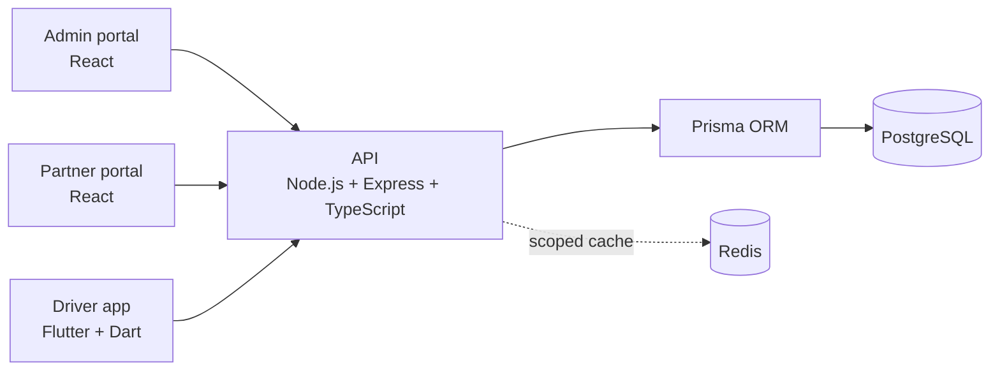

# Technology stack

**Status:** selected technology direction for implementation review, updated 11 October 2026. This document records the requested stack and recommended baseline packages; it does not install packages, pin versions or replace the architecture, API, security or decision documents.

## 1. Stack at a glance

| Area | Selected technology | Purpose |
| --- | --- | --- |
| Web portals | React, Node.js and Express (the web portion of the requested MERN stack) | Admin and partner browser applications, plus their API |
| Backend | TypeScript, Node.js and Express modular monolith | API, authorization, workflows and background worker |
| Database | PostgreSQL with Prisma ORM | Authoritative relational data, financial records and transactions |
| Mobile app | Flutter and Dart | Android driver application |
| Cache | Redis | Explicitly scoped, rebuildable cached reads; not financial authority |
| Local/deployed runtime | Docker; managed PostgreSQL in staging/production | Reproducible local environment and operated database |

### PostgreSQL rather than MongoDB

MERN commonly expands to **MongoDB, Express, React and Node.js**. For BASAP, use React, Express and Node.js from that familiar web stack, but **do not add MongoDB**: PostgreSQL is the selected source of truth. It is required for the relational model, constraints and atomic financial workflows already specified for the project. Prisma is the backend data-access layer for PostgreSQL.

The React admin and partner portals and the Flutter app call the same Express API. Neither client connects to PostgreSQL or Redis directly.

## 2. Backend packages to adopt

Use the newest stable **compatible** versions when the backend is scaffolded, then pin them in the relevant `package.json` and lockfile. Validate the exact versions together because Express, Prisma, the PostgreSQL driver and Node.js must be compatible.

| Need | Recommended package(s) | Required use |
| --- | --- | --- |
| HTTP API | `express`, `typescript` | Build modular route/controller/service boundaries; keep authorization in services. |
| Database | `prisma`, `@prisma/client`, `pg` | Use PostgreSQL through Prisma and its transaction context. Retain reviewed SQL migrations/constraints where Prisma cannot express an invariant. |
| Request validation | `zod` | Validate every untrusted body, params and query; reject unknown fields. Types alone are not request validation. |
| HTTP hardening | `helmet` | Set reviewed security headers. Configure CSP deliberately for the React portal/API deployment rather than accepting a permissive default. |
| Browser-origin control | `cors` | Allow only configured portal origins and methods. CORS supplements, never replaces, authentication and authorization. |
| Abuse controls | `express-rate-limit`; `rate-limit-redis` only if Redis is selected as the shared store | Protect login, refresh, onboarding, close-code attempts and uploads. Set values and outage behaviour in the security review; use a secure fallback or fail closed for controls that are required. |
| Password hashing | `argon2` | Hash passwords using Argon2id with reviewed parameters; never log or store plaintext passwords. |
| Tokens/crypto | Node.js built-in `crypto`; `jose` only if signed-token handling is selected | Generate secure values with `crypto`. The refresh-token/session and signing design remains DEC-03; do not choose a JWT library as a substitute for that decision. |
| Environment validation | `zod` (for a typed startup schema) | Validate required configuration at startup and fail without printing secret values. Do not expose backend secrets in browser or mobile builds. |
| Logging | `pino`, `pino-http` | Produce structured, request-correlated logs with field redaction for credentials, tokens, close codes, document data, URLs and file metadata. |
| Testing | `vitest` or `jest`; `supertest` | Pick one test runner during toolchain setup. Test access denial, validation, rate limits, replay handling and PostgreSQL transactions against real integrations. |

Avoid a generic mass-assignment helper or a generic `req.body`-to-Prisma mapper. DTO schemas and explicit service commands must decide which fields may change.

## 3. React web packages to adopt

| Need | Recommended package(s) | Required use |
| --- | --- | --- |
| UI | `react`, `react-dom`, `typescript` | Build separate admin and partner portals against the documented API. |
| Navigation | `react-router-dom` | Guard routes for user experience, while keeping every real permission check in the API. |
| Server-state requests | `@tanstack/react-query` | Fetch, cache and invalidate API data; never treat client cache as authorization. |
| Forms and validation | `react-hook-form`, `zod`, `@hookform/resolvers` | Validate before submission for usability and repeat the same rules at the API boundary. |
| HTTP client | `fetch` or `axios` | Use a central client with timeouts and safe error handling. Do not put refresh tokens in `localStorage`. |
| Client error reporting | Project-selected service SDK, if one is approved | Scrub tokens, personal documents, signed URLs and close codes before sending telemetry. |

Keep access tokens in memory. If the team chooses HttpOnly cookie/BFF refresh transport, implement CSRF protection and update the API/security contracts together; do not add a client-side CSRF package to a JSON-token flow without that design decision.

## 4. Flutter mobile packages to adopt

| Need | Recommended package(s) | Required use |
| --- | --- | --- |
| Networking | `dio` | Centralize API base URL, timeout, retry and authenticated-request handling. Retry only safe/idempotent operations; use the documented command identity for mutations. |
| Secure credential storage | `flutter_secure_storage` | Store refresh credentials only in platform-backed secure storage. Never use ordinary preferences for credentials. |
| State management | `flutter_riverpod` | Keep UI, network state and unsynced drafts explicit. This is a recommended project convention, not a server security boundary. |
| Routing | `go_router` | Structure mobile navigation and redirect unauthenticated users. The API remains the source of authorization. |
| Input validation | `formz` or app-owned validators | Give immediate form feedback while retaining server-side validation as authoritative. |
| TLS/certificate handling | `dio` plus platform network security configuration | Use HTTPS for deployed services. Do not disable certificate validation; any certificate-pinning choice needs separate operational review and rotation planning. |
| Sensitive-data protection | `local_auth` only if a product requirement approves it | Optional device re-authentication for local app access; it must not replace server sessions or authorization. |

Mobile logs, crash reports and analytics must redact access/refresh credentials, close codes, document numbers, private URLs and image/file content.

## 5. Security baseline for every implementation PR

- Enforce authentication, role and resource relationship checks in the Express API for every protected request.
- Validate and allowlist all API input with runtime schemas. Parameterize database access through Prisma or reviewed bound SQL.
- Use TLS in deployed environments; restrict CORS to real portal origins; apply Helmet headers; configure rate limits for sensitive endpoints.
- Use PostgreSQL transactions, constraints and uniqueness rules for financial consistency. Redis is never the authoritative store for balances, payroll, replay records or authorization.
- Keep uploaded files private, quarantined and scanned before attachment/download. Do not expose public storage URLs.
- Store secrets in environment/secret management, validate them at startup and keep them out of commits, images, browser bundles and mobile assets.
- Run dependency vulnerability checks and keep a lockfile. Review updates and their changelogs instead of blindly applying automated upgrades.
- Add tests for authentication/session revocation, authorization scope, validation, abuse limits, upload isolation and sensitive-log redaction.

## 6. Review and open choices

The stack direction is ready to review. Before implementation, the team must still pin tested versions and resolve the listed decisions:

| Review item | Tracking |
| --- | --- |
| Node.js, React, Flutter, Prisma, PostgreSQL and test-tool versions; workspace layout | DEC-01 |
| Managed database, Redis, object storage, file scanner and email providers | DEC-02 |
| Session/refresh transport, token lifetimes and password policy | DEC-03 |
| Close-code encryption, key management and attempt limits | DEC-04 |
| Redis cache/rate-limit store policy and failure behaviour | DEC-30 |

Use this guide with the [system architecture](system-architecture.md), [security design](security-design.md), [developer setup](developer-setup.md) and [decision log](decision-log.md). A dependency listed here becomes an implementation choice only after version, compatibility, configuration and security review are recorded in the relevant PR.
