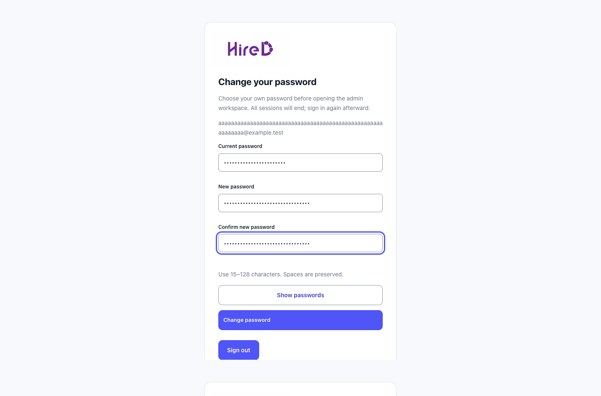
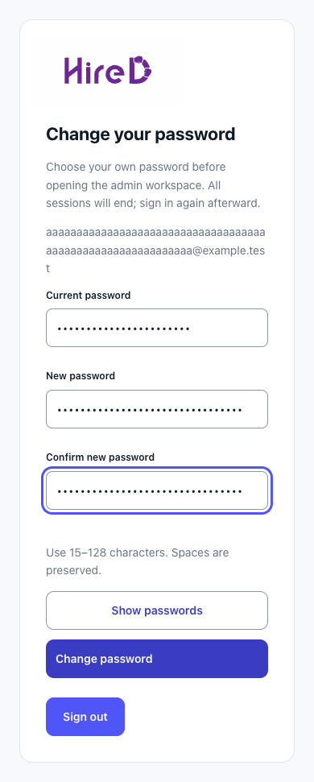

# Admin password setup verification

Captured 17 October 2026 from the saved `admin-portal/e2e/password-change.spec.ts` regression using synthetic intercepted data and masked passwords. Desktop is 1440px and mobile 390px; the same flow checks overflow at 320/390/768/1440px. Live API/PostgreSQL verification is recorded separately in the [backend verification record](../../../backend/README.md#verification).

