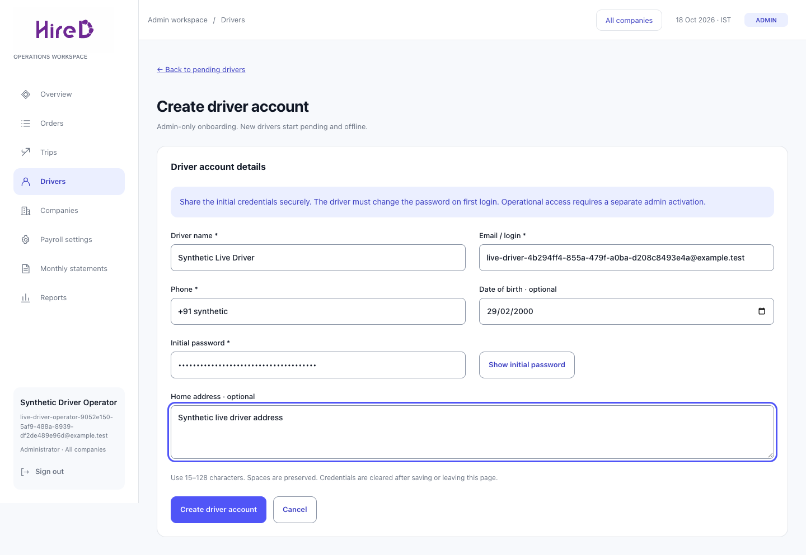
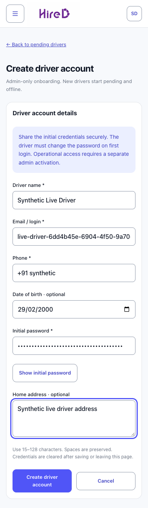

# Driver provisioning verification

Captured 18 October 2026 by `admin-portal/e2e-live/drivers.spec.ts` against the real API and disposable PostgreSQL. Desktop is 1440px and mobile 390px. All identity/contact data and passwords are synthetic; passwords are masked. Mock browser coverage separately verifies 320/390/768/1440px layouts, throttling and uncertain-result recovery. See [driver policy](../../../backend/drivers.md).

