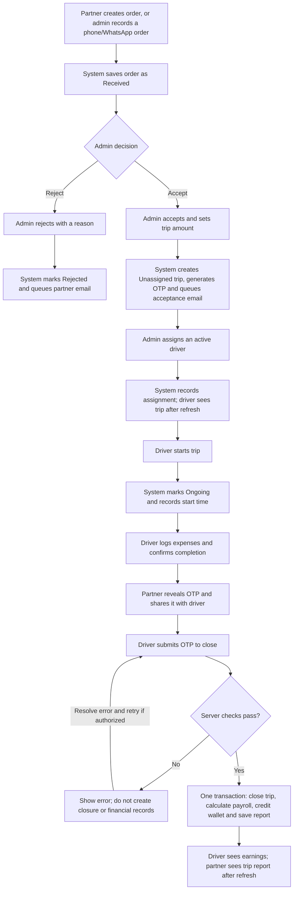
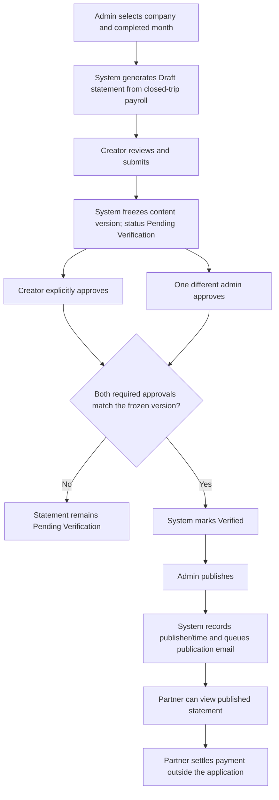
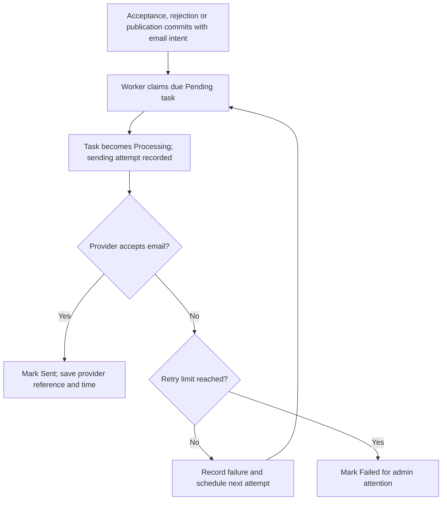

# HireD Application Workflows

**Scope:** Phase 1 MVP

**Based on:** The current [BASAP database design](database/database-design.md) and the reviewed [HireD PRD v0.2](https://github.com/shahid123s/buildathon-resources/blob/main/hire_d_prd_doc.md).

This document explains how partner, admin and driver actions connect through the backend, including automatic database updates, background email tasks and actions required from other users. It describes planned behavior, not an implemented application. Proposed policies and unresolved requirements are identified below.

## 1. Users and execution model

| Actor | Responsibility |
| --- | --- |
| Partner | Place orders, track trips, reveal/share close codes, view trip reports and published statements |
| Admin | Manage companies/accounts, activate drivers, decide orders, assign/reassign trips, configure rates, generate/approve/publish statements and view reports |
| Driver | Upload documents, maintain availability, execute assignments, log expenses, enter close codes and view earnings/history |
| Backend | Validate authorization and state, maintain records, calculate payroll, credit wallets and generate reports |
| Email worker | Send committed notification intents and manage delivery attempts/retries |

Automatic database changes happen when an authorized request commits. Other users' screens reflect those changes when they fetch or refresh data; this design does not imply push notifications or GPS tracking.

## 2. Account, company and driver preparation

At least two distinct admin accounts are needed for statement verification. All admins have the same role; statement creator/approver checks are business rules.

| User action | Automatic background work | Who acts next? |
| --- | --- | --- |
| Admin creates a company and sets its payout split | Save the company and initial rate, such as driver 30% / company 70%. Validate that both percentages total 100%. | Admin creates the partner login. |
| Admin creates a partner account | Save the account and link it to the company. Future requests derive company scope from this account relationship. | Partner logs in and places orders. |
| Driver submits an application and uploads documents | Create a pending driver profile. Store files privately and save metadata/document references. Public self-registration is a proposed entry mechanism. | Admin sees the application and uploads in the onboarding queue. |
| Admin activates the driver | Record operational status, first activation time and activating admin. | Driver becomes eligible for assignment and trip execution. |

The four document types are driving license, Aadhaar, PAN and PCC. Requiring all four current uploads before activation is a proposed policy. Activation means operational access; formal document verification is outside Phase 1. Driver availability remains separate from activation.

**Related tables:** `users`, `auth_sessions`, `companies`, `company_users`, `company_payout_rates`, `drivers`, `driver_documents`, `file_assets`.

## 3. Order-to-trip flow



The diagram shows a typical sequence. The partner can reveal the code for its authorized active trip before the driver reaches the closure screen; sharing it remains a human action.

### 3.1 Intake and admin decision

| User/system action | Automatic background work | Related action or result |
| --- | --- | --- |
| Partner submits an order | Validate route, schedule, vehicle/service notes and contact details. Derive company ownership from the account and save a `received` order. | Order appears in the partner list and admin inbox. |
| Admin records a phone/WhatsApp request | Save the same type of order with the selected company, admin identity and booking source. | It enters the same decision workflow as portal orders. |
| System obtains a route estimate | Store maps-derived duration when available. Preserve the precedence of an existing admin override. | Tracking shows the estimate or "Estimate unavailable." |
| Admin rejects the order | Save reason, rejection actor/time and a rejection-email intent in the same transaction. | Partner sees rejected status; the worker attempts the email afterward. |
| Admin accepts and confirms the amount | Mark accepted; create exactly one trip; copy accepted route, schedule, contacts, notes and estimate; generate the trip OTP; save an acceptance-email intent. | Trip is `unassigned`; admin selects a driver. Final payroll is calculated at closure. |

Acceptance/rejection retries must not create a duplicate trip or duplicate email intent. The OTP is stored securely for validation and authorized partner reveal; it is not included in driver trip responses, email content or logs.

If no driver is available, the proposed behavior is to keep the trip unassigned for admin attention rather than automatically cancel it.

**Related tables:** `orders`, `trips`, `notifications`, `audit_logs`.

### 3.2 Assignment and execution

| User action | Automatic background work | Related action or result |
| --- | --- | --- |
| Admin assigns a driver | Check eligibility, update current driver, record assignment history and set trip to `assigned`. | Driver sees the assignment after fetching updated data. There is no driver accept/reject step. |
| Driver uploads a selfie | Store the image privately and attach its reference to the authorized trip. | Driver proceeds to start. Selfie is P1; making it mandatory before start remains unresolved. |
| Driver starts the trip | Check current assignment and state, record server start time and set trip to `ongoing`. | Admin/partner tracking can show execution has started. Repeated authorized start requests do not start it again. |
| Driver adds/edits/deletes an expense | Save the change and clear any previous expense confirmation. Receipt attachment is optional. | Driver reviews the final expense list before closure. |
| Driver confirms all expenses | Record confirmation time and confirming driver. The proposed "No expenses" action explicitly confirms an empty list. | Closure can proceed once all other checks pass. |
| Partner reveals and shares the OTP | Authorize the partner against the trip company and return the code through a dedicated reveal action. | Partner communicates the code to the driver. |
| Driver submits the OTP | Check active account, current assignment, trip state, expense confirmation and code. | Correct input triggers closure. Wrong input leaves the trip open and records the failed attempt. |

Recorded expenses have positive amounts and nonempty descriptions. Category is optional at entry and defaults to `other`; there is no PRD-mandated category catalog. Any expense mutation or reassignment requires confirmation again. Expiry, replacement-code and lockout details remain policy decisions.

**Related tables:** `trips`, `trip_assignments`, `trip_selfies`, `trip_expenses`, `file_assets`.

## 4. Atomic trip closure

Trip closure, payroll, wallet credit and report generation must succeed in one database transaction.

```mermaid
sequenceDiagram
    participant D as Driver
    participant B as Backend
    participant DB as Database transaction
    D->>B: Close trip with OTP
    B->>DB: Lock company, then trip
    B->>DB: Validate account, assignment, state, expenses and OTP
    B->>DB: Read company rate effective at closure
    B->>DB: Close trip and complete active assignment
    B->>DB: Insert payroll and one wallet credit; update balance
    B->>DB: Validate and save report snapshot; record audit
    B->>DB: Commit all changes
    B-->>D: Return persisted closure, report and credit details
```

| Automatic step | Purpose |
| --- | --- |
| Lock and validate | Coordinate with reassignment and rate changes; confirm the driver is still authorized. |
| Calculate payroll | Read the company rate effective at closure and calculate both shares using exact decimal arithmetic. |
| Close execution | Record closure time and complete the active assignment. |
| Record earnings | Create one payroll record and one wallet credit; update cached wallet balance. |
| Generate report | Build the trip/expense/payroll snapshot, validate its format and save it. |
| Commit | Make the trip, financial records and report visible together. |

The report format is defined by [trip-report-snapshot.schema.json](database/trip-report-snapshot.schema.json). The backend must also reconcile IDs, ownership, timestamps and arithmetic; JSON Schema alone does not enforce those checks.

### 4.1 Financial example

Suppose a trip amount is ₹10,000, the company split is 30/70 and expenses are ₹150.

| Result | Value |
| --- | ---: |
| Driver share and wallet credit | ₹3,000 |
| Company share | ₹7,000 |
| Expenses shown separately in the report | ₹150 |

Under the working expense rule, the ₹150 does not alter the commission split or create another wallet credit. Expense reimbursement remains open. Partner payment timing does not delay the driver's credit.

### 4.2 Failure and retry behavior

- Failed closure rolls back trip, payroll, report and wallet changes together.
- Failed OTP counters persist separately from rolled-back financial writes; no report or credit is created for an invalid code.
- If closure commits but the response is lost, an authorized retry returns the existing payroll/report/credit result without another payout.
- A uniqueness rule on trip payroll and trip credit provides an additional defense against duplicate earnings.
- An offline app cannot declare a trip closed or infer a payout. Start, expense confirmation and closure require connectivity.

### 4.3 Results available to users

| User | Result after the transaction commits |
| --- | --- |
| Driver | Credit, wallet balance and completed-trip history |
| Partner | Closed-trip report with expenses and financial breakdown |
| Admin | Closed trip, payroll and updated report queries |

The financial calculation and report snapshot remain frozen. Screens display these results after fetching current data. A later external payment-status update does not rewrite the report's status-at-closure snapshot.

**Related tables:** `trips`, `trip_assignments`, `trip_payroll_records`, `wallet_transactions`, `wallet_accounts`, `trip_reports`, `audit_logs`. Optional scoring updates participate in closure only if that extension is enabled.

## 5. Monthly statement and publication

Admin starts statement generation; it is not an automatic month-end scheduler in the current proposal.



The two approvals can happen in either order. Creating the statement does not count as creator approval.

| User action | Automatic background work | Related action or result |
| --- | --- | --- |
| Admin generates a statement | Select company closed trips for the month, copy payroll amounts/rates into lines and calculate totals. | Creator reviews the draft. |
| Creator regenerates a draft | Replace lines/totals atomically and increment the content version. | Creator reviews the revised draft. |
| Creator submits | Record submission time, freeze content and set `pending_verification`. | Creator and another admin explicitly approve. |
| Admin approves | Record identity, time and content version. Check whether the creator-plus-one-other-admin pair exists. | After both valid approvals, set `verified`. |
| Admin publishes | Recheck approvals, record publisher/time, set `published` and create a publication-email intent in the same transaction. | Partner can access the statement under the proposed published-only gate. |
| Partner pays outside the app | No in-app collection occurs. | Admin may record external settlement metadata; this does not recalculate earnings or credit the wallet again. |

Two noncreator admins cannot substitute for the creator. An approval for another content version cannot satisfy verification. Repeated approval/publication requests must not duplicate approvals or email intents.

The proposed policy is one statement per company/calendar month, selecting actual trip closure times in `Asia/Kolkata` and generating completed months only. Lines preserve applied rates and amounts; later rate edits do not change published totals. Expenses do not inflate commission totals under the working rule.

The PRD requires verification before partner access and also names a distinct publication stage. The current proposal requires publication as well; this remains a clarification. Revision after submission, creator unavailability and dispute workflows require separate decisions.

**Related tables:** `statements`, `statement_items`, `statement_approvals`, `trip_payroll_records`, `notifications`, `audit_logs`.

## 6. Actions alongside the main workflow

| Action | Background effects and related user work |
| --- | --- |
| Admin edits the trip amount before closure | Update amount and audit before/after values. Closure uses the final amount; closed financial records remain frozen. |
| Admin changes the company split | Preserve rate history. Trips closed afterward use the applicable new rate; previously closed payroll remains unchanged. |
| Admin reassigns an assigned/ongoing trip | End previous assignment, record new assignment, revoke old driver's operational access and clear expense confirmation. Preserve existing expenses and the original start time. |
| New driver takes over an ongoing trip | Review the combined expense list and confirm it again. Paying the entire share to the closing driver is a proposal; contribution splitting is unspecified. |
| Driver changes availability | Update online/calendar data for the admin directory. This does not automatically assign or reassign trips. |
| Admin overrides the estimate | Save override and actor/time, audit the change, and retain override precedence until explicitly cleared. |
| Driver replaces a document | Preserve the previous document and mark the replacement current. This is P2 and does not imply formal verification. |

Closed-trip reassignment is prohibited in the current proposal to preserve immutable finances; the PRD's "at any time" wording needs clarification. The previous driver's queued writes must be reauthorized and rejected after reassignment. Admin, partner and affected driver views refresh their authoritative data.

## 7. Background email delivery



- Required email events are acceptance, rejection and statement publication. Rejection email is also part of the P0 order-decision requirement.
- Save the email intent in the same database transaction as its business action; sending occurs afterward.
- Unique event/resource/recipient/channel keys prevent duplicate intent creation.
- Leases allow recovery when a worker crashes; only the current claim can acknowledge an attempt.
- Email failure does not undo acceptance, rejection or publication. A published statement remains accessible during an email outage.
- `sent` means provider acceptance, not proof of inbox delivery or reading. Duplicate-free provider delivery requires provider idempotency when recovering from a crash after sending.
- Recipient selection, retry/backoff limits and other notification channels are proposed policies. Missing recipients must be visible for admin attention.

**Related table:** `notifications`.

## 8. Reporting, access and audit

Admin reporting queries the committed operational and financial records. The seven required reports are billing issues, driver delays, client order volume/success, driver payouts, trips, orders and driver/staff work.

- Admin can view all companies or selected companies; all admins share the same access role.
- Partners remain restricted to their own company and drivers to their own authorized data/history.
- Apply scope consistently to rows, counts, totals, attachments and exports. Pagination must not change whole-range totals.
- No extra report-generation approval is required for ordinary admin query results. Statement generation and closed-trip snapshots have their own workflows above.
- Delay/on-time thresholds and the definition of "live" reporting remain provisional. Optional driver scores and streaks are a separate extension.
- Audit rate edits, trip amount changes, reassignment, approvals and publication with actor, action and time. Exclude OTPs, credentials and private file secrets.

For table/field definitions, constraints and indexes, see [hired.dbml](database/hired.dbml), [database-design.md](database/database-design.md) and [indexing-strategy.md](database/indexing-strategy.md). Open decisions and planned acceptance checks are recorded in [prd-validation.md](database/prd-validation.md).
